# 🎗️ Breast Cancer Classification & Machine Learning Analysis

[](https://www.python.org/)
[](https://scikit-learn.org/)
[](https://xgboost.readthedocs.io/)
[](https://pandas.pydata.org/)
[](https://jupyter.org/)
[](LICENSE)

An end-to-end diagnostic machine learning study on the **Wisconsin Breast Cancer (Diagnostic) Dataset**. This project implements data preprocessing, exploratory data analysis (EDA), multi-model benchmarking, hyperparameter tuning, clinical decision threshold optimization, biomarker feature importance, and production-ready model serialization.

---

## 📌 Executive Summary & Objective

In clinical oncology, **early and accurate detection of malignant breast tumors** is critical to improving patient prognosis and survival rates. Missing a malignant case (**False Negative**) can have catastrophic consequences for patient care. 

This repository develops, benchmarks, and optimizes multiple supervised classification algorithms to differentiate between **Benign (non-cancerous)** and **Malignant (cancerous)** breast tumors based on features extracted from digitized images of Fine Needle Aspirate (FNA) biopsy samples.

### Key Highlights:
- **Comprehensive Analysis**: End-to-end workflow documented in [`breast_cancer_analysis.ipynb`](breast_cancer_analysis.ipynb).
- **High Diagnostic Accuracy**: Tuned Random Forest and XGBoost achieve **97.37% test accuracy** and **100% precision**.
- **Clinical Sensitivity Optimization**: Calibrated decision threshold from `0.50` to `0.30`, boosting **recall (sensitivity) to 97.62%** and minimizing false negatives.
- **Biomarker Discovery**: Identified `concave points_worst`, `concave points_mean`, `area_worst`, and `radius_worst` as top predictive morphological indicators of malignancy.
- **Production Persistence**: Fully trained model and preprocessor serialized to `models/` for immediate inference.

---

## 📁 Repository Structure

```text
Breast-Cancer-Classification/
│
├── breast_cancer_analysis.ipynb              # 🌟 Main comprehensive analysis & ML benchmark notebook
├── breast_cancer.csv                         # Wisconsin Diagnostic Breast Cancer dataset
│
├── dataset/
│   ├── breast_cancer.csv                     # Wisconsin Breast Cancer Dataset (Classification)
│   └── housing.csv                           # California Housing Dataset (Regression reference)
│
├── notebooks/                                # Algorithm-specific reference notebooks
│   ├── logistic_regression.ipynb             # Logistic Regression exploration
│   ├── decision_tree.ipynb                   # Decision Tree Classifier
│   ├── random_forest.ipynb                   # Random Forest Classifier
│   ├── xgboost.ipynb                         # XGBoost Classifier
│   ├── cross_validation_hyperparameter_tuning.ipynb # Grid search & CV exploration
│   └── linear_regression.ipynb               # Linear Regression (House Price Prediction)
│
├── models/                                   # Serialized production model artifacts
│   ├── breast_cancer_model.joblib            # Trained Random Forest classifier
│   ├── scaler.joblib                         # Fitted StandardScaler preprocessor
│   └── .gitkeep
│
├── outputs/                                  # Exported publication-ready plots
│   ├── diagnosis_distribution.png            # Class counts & proportions
│   ├── correlation_heatmap.png               # Biomarker correlation matrix
│   ├── model_comparison.png                  # Multi-model evaluation benchmark
│   ├── confusion_matrix.png                  # Confusion matrices comparison
│   └── .gitkeep
│
├── requirements.txt                          # Python dependencies
├── README.md                                 # Project documentation
└── .gitignore                                # Git ignore configurations
```

---

## 📊 Dataset Description

The dataset corresponds to the **Breast Cancer Wisconsin (Diagnostic) Dataset** from the UCI Machine Learning Repository. Features are computed from digitized images of fine needle aspirates (FNA) of breast masses describing characteristics of cell nuclei.

| Attribute | Details |
| :--- | :--- |
| **Total Instances** | 569 patients |
| **Feature Count** | 30 real-valued morphological metrics |
| **Target Variable** | `diagnosis`: **Benign (B)**: 357 (62.7%), **Malignant (M)**: 212 (37.3%) |
| **Missing Values** | 0 (Clean dataset) |
| **Feature Groups** | Mean, Standard Error (SE), and "Worst" (mean of the three largest values) |

### Core Morphological Characteristics
For each cell nucleus, ten primary features are recorded:
1. **Radius**: Mean of distances from center to perimeter points
2. **Texture**: Standard deviation of gray-scale values
3. **Perimeter**: Nuclear boundary length
4. **Area**: Nuclear cross-sectional area
5. **Smoothness**: Local variation in radius lengths
6. **Compactness**: $\frac{\text{perimeter}^2}{\text{area}} - 1.0$
7. **Concavity**: Severity of concave portions of the contour
8. **Concave Points**: Number of concave portions of the contour
9. **Symmetry**: Nuclear symmetry
10. **Fractal Dimension**: "Coastline approximation" ($- 1.0$)

---

## 🧠 Machine Learning Workflow

```mermaid
flowchart LR
    A[Data Ingestion<br/>569 Samples] --> B[Data Preprocessing<br/>Encode Target & Drop ID]
    B --> C[Exploratory Data Analysis<br/>Distribution & Correlations]
    C --> D[Stratified Split<br/>80% Train / 20% Test]
    D --> E[StandardScaler<br/>Zero Mean & Unit Variance]
    E --> F[Multi-Model Benchmark<br/>LR, DT, RF, XGBoost]
    F --> G[GridSearchCV Tuning<br/>Optimize Recall]
    G --> H[Threshold Calibration<br/>Threshold = 0.30]
    H --> I[Model Persistence<br/>Export to joblib]
```



1. **Preprocessing**: 
   - Removed identifier column `id`.
   - Encoded binary targets: Malignant (`M`) $\rightarrow 1$, Benign (`B`) $\rightarrow 0$.
2. **Stratification**: 
   - 80% Training (455 samples) and 20% Testing (114 samples) using `stratify=y` to maintain exact class proportions.
3. **Standardization**: 
   - Fitted `StandardScaler` strictly on training data and transformed test data to prevent data leakage.
4. **Benchmarking**: 
   - Evaluated Logistic Regression, Decision Tree, Random Forest, and XGBoost using Stratified 5-Fold Cross-Validation.
5. **Hyperparameter Tuning**: 
   - Conducted Stratified 5-Fold `GridSearchCV` on Random Forest, tuning `n_estimators`, `max_depth`, `min_samples_split`, and splitting `criterion` to optimize diagnostic recall.
6. **Clinical Threshold Tuning**: 
   - Evaluated decision boundaries from $0.10$ to $0.90$ to align predictive behavior with medical requirements (minimizing False Negatives).

---

## 🏆 Model Benchmarking & Results

All models were evaluated on the independent, stratified test set (114 samples: 72 Benign, 42 Malignant):

| Model | Test Accuracy | Precision | Recall (Sensitivity) | F1-Score | ROC-AUC | 5-Fold CV Accuracy |
| :--- | :---: | :---: | :---: | :---: | :---: | :---: |
| **XGBoost** | **97.37%** | **1.0000** | 0.9286 | **0.9630** | **0.9940** | 96.70% |
| **Random Forest (Tuned)** | **97.37%** | **1.0000** | 0.9286 | **0.9630** | 0.9929 | 96.26% |
| **Logistic Regression** | 96.49% | 0.9750 | 0.9286 | 0.9512 | **0.9960** | **97.14%** |
| **Decision Tree** | 92.11% | 0.9459 | 0.8333 | 0.8861 | 0.9448 | 93.41% |

### Detailed Classification Report (Tuned Random Forest)

```text
               precision    recall  f1-score   support

   Benign (0)       0.96      1.00      0.98        72
Malignant (1)       1.00      0.93      0.96        42

     accuracy                           0.97       114
    macro avg       0.98      0.96      0.97       114
 weighted avg       0.97      0.97      0.97       114
```

---

## 🎯 Clinical Threshold Optimization

In clinical diagnostic testing, standard default decision thresholds ($0.50$) can produce unacceptable False Negatives. By adjusting the probability threshold, clinicians can prioritize sensitivity:

| Threshold | Precision | Recall (Sensitivity) | F1-Score | Clinical Implication |
| :---: | :---: | :---: | :---: | :--- |
| **0.10** | 0.8913 | 0.9762 | 0.9318 | Aggressive screening (Higher false positives) |
| **0.20** | 0.9111 | 0.9762 | 0.9425 | High sensitivity, good precision |
| **0.30** | **0.9762** | **0.9762** | **0.9762** | **Optimal Clinical Operating Point** ⭐ |
| **0.40** | 0.9756 | 0.9524 | 0.9639 | High precision, strong recall |
| **0.50** | 0.9750 | 0.9286 | 0.9512 | Standard default threshold |
| **0.60** | 1.0000 | 0.9048 | 0.9500 | Conservative (Zero false positives, more missed cases) |

> 💡 **Recommendation**: Operating at a threshold of **`0.30`** captures **97.62%** of malignant cases while sustaining an exceptional **97.62%** precision, preventing missed cancer diagnoses.

---

## 📈 Visualizations & Artifacts

All plots are automatically generated and saved in [`outputs/`](outputs/):

| Visual Plot | File Location | Key Insight |
| :--- | :--- | :--- |
| **Diagnosis Distribution** | [`outputs/diagnosis_distribution.png`](outputs/diagnosis_distribution.png) | 62.7% Benign vs 37.3% Malignant balance |
| **Correlation Heatmap** | [`outputs/correlation_heatmap.png`](outputs/correlation_heatmap.png) | Nuclear concavity and perimeter strongly correlate with malignancy |
| **Model Comparison** | [`outputs/model_comparison.png`](outputs/model_comparison.png) | Side-by-side benchmark across accuracy, recall, and ROC-AUC |
| **Confusion Matrix** | [`outputs/confusion_matrix.png`](outputs/confusion_matrix.png) | Direct comparison between Logistic Regression and Tuned Random Forest |

---

## 🔬 Top Predictive Biomarkers

Extracted using Mean Decrease in Impurity (Gini Importance) from the Random Forest model:

1. **`concave points_worst`** (11.0%)
2. **`concave points_mean`** (10.4%)
3. **`area_worst`** (10.3%)
4. **`radius_worst`** (9.9%)
5. **`perimeter_mean`** (8.3%)

*Irregularities in nuclear concavity and enlargement in worst-case nuclear size are the single strongest indicators of tumor malignancy.*

---

## 🚀 Getting Started

### 1. Clone the Repository
```bash
git clone https://github.com/<your-username>/Breast-Cancer-Classification.git
cd Breast-Cancer-Classification
```

### 2. Set Up Virtual Environment
```bash
# Windows
python -m venv venv
venv\Scripts\activate

# macOS / Linux
python3 -m venv venv
source venv/bin/activate
```

### 3. Install Dependencies
```bash
pip install -r requirements.txt
```

### 4. Launch Jupyter Notebook
```bash
jupyter notebook breast_cancer_analysis.ipynb
```

---

## 💻 Sample Inference with Saved Model

You can load and use the trained production model with just a few lines of Python:

```python
import joblib
import pandas as pd

# Load saved model and preprocessor
model = joblib.load('models/breast_cancer_model.joblib')
scaler = joblib.load('models/scaler.joblib')

# Load new patient data (30 features)
new_patient = pd.read_csv('breast_cancer.csv').drop(columns=['id', 'diagnosis']).iloc[[0]]

# Generate prediction and probability
prediction = model.predict(new_patient)[0]
probabilities = model.predict_proba(new_patient)[0]

diagnosis = "Malignant" if prediction == 1 else "Benign"
confidence = probabilities[prediction] * 100

print(f"Predicted Diagnosis: {diagnosis} ({confidence:.2f}% confidence)")
```

---

## 🛠️ Tech Stack & Dependencies

- **Programming Language**: Python 3.10+
- **Data Manipulation**: `pandas`, `numpy`
- **Machine Learning**: `scikit-learn`, `xgboost`
- **Visualization**: `matplotlib`, `seaborn`
- **Model Serialization**: `joblib`
- **Interactive Computing**: `ipykernel`, `jupyter`

---

## 📄 License

This project is licensed under the MIT License - see the [LICENSE](LICENSE) file for details.
